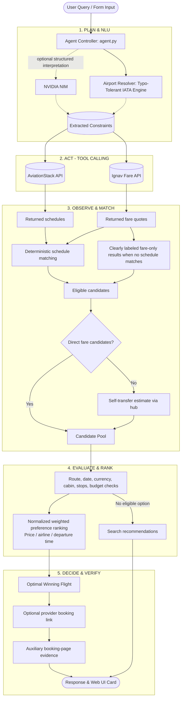

<div align="center">

# ✈️ T10 Flight Intelligence Platform
### *Flight Option Finder & Verification Agent — deterministic search with optional request interpretation*

[](https://python.org)
[](https://fastapi.tiangolo.com)
[](https://build.nvidia.com)

<br/>

[Explore Architecture](#-system-architecture) • [Getting Started](#-getting-started) • [Web App and API](#-web-app-and-api) • [Test Suite](#-test-suite--verification)

</div>

---

## 📖 Executive Summary

**T10 Flight Option Finder** is a Python flight-search application with a browser interface and FastAPI backend. It queries AviationStack for schedules and Ignav for fares when credentials and provider plans allow. NVIDIA NIM can optionally interpret an unresolved route in a natural-language request; deterministic validation, matching, filtering, and ranking remain in Python.

Unlike naive LLM wrappers that fabricate prices or guess flight numbers, this agent enforces a **strict boundary between intelligence and data validation**:
1. A deterministic parser handles supported natural-language fields first. When a route cannot be resolved and an NVIDIA key is configured, NIM may fill the missing route; output is validated as a `SearchRequest`, and service/output failures fall back to deterministic parsing.
2. Python enforces route, date, currency, cabin, stop, and budget constraints; schedule matching and preference ranking are deterministic.
3. AviationStack schedules, Ignav fare quotes, provider booking links, and auxiliary booking-page checks are distinct evidence sources. A fare quote, a schedule match, a booking-page check, and current seat availability are not interchangeable. The application does not guarantee bookability or live inventory.

---

## 🌟 Key Highlights & Innovations

### 1. 🛡️ Provider-sourced results
The application does not synthesize schedule or fare data. Results depend on configured providers, their response quality, account permissions, and freshness. A returned fare does not establish seat availability or final checkout price.

### 2. 🔄 Multi-hub self-transfer estimates
When no direct candidate satisfies the request and stops are allowed, the agent can look for two-leg options through **Delhi (`DEL`)**, **Mumbai (`BOM`)**, **Bengaluru (`BLR`)**, and **Hyderabad (`HYD`)**. It checks schedule timestamps and local time zones and accepts layovers from **60 through 720 minutes inclusive**. It also filters non-Indian carriers from domestic Indian candidates using a code/name allowlist; this is an application filter, not a legal determination.

These are **separate-ticket estimates**, not protected connections or confirmed through-tickets. The itinerary is only considered if both leg fares use the requested currency and the combined amount meets the budget. Both legs must have usable timestamps; each leg must be booked separately.

### 3. 🌍 Airport resolution
The airport resolver maps supported city names, aliases, and IATA codes to airport records, including Indian regional airports and major international hubs. It uses `difflib` fuzzy matching with a `0.60` cutoff. The browser's autocomplete list is a curated subset, not the full resolver database; actual support depends on the records in `airport_resolver.py`.

### 4. 🧠 Per-session conversational memory
The browser receives an HTTP-only session cookie and the backend keeps that session's preferences and turn history in process memory. Follow-up queries can reuse route, date, and preference values. This memory is not persisted across application restarts or shared across multiple server workers.

### 5. 💡 No-result guidance
If no candidate meets the hard constraints, the response can report the cheapest returned fare above budget, nearby-airport suggestions when configured, and date-flexibility advice. These are suggestions; the application does not automatically search alternate airports or dates.

### 6. 🔗 Booking-link evidence
Provider booking links may be returned when available. If needed, the auxiliary verifier checks public pages on approved HTTPS domains and reports `passed`, `partial`, `unavailable`, or `failed`. A booking/search link or a successful page check is not proof of a completed booking, live inventory, or final checkout price.

---

## 🏛️ System Architecture



---

## 🌐 Web app and API

The browser UI is HTML, CSS, and JavaScript served by FastAPI from `/`. It offers:

- A structured form for origin and destination text inputs, travel date, optional budget and currency, passenger count, cabin class, preferred departure window, and maximum stops. Origin and destination use HTML datalist suggestions; users can also enter other resolvable names or codes.
- A natural-language prompt tab. The parser can extract supported dates, routes, budgets/currencies, passenger counts, cabin class, airline preferences, departure windows, and stop limits. NVIDIA NIM request interpretation is optional and is only called when `NVIDIA_API_KEY` is configured; it does not select or rank flight results.
- A recommendation card, an empty-state/suggestions panel, the request breakdown, an agent trace, and a table of up to 15 fare/match records. Booking and schedule evidence, fare status, freshness, and availability caveats are shown separately.
- A progress stepper populated from the trace after the search response arrives. Search execution is a single request; progress is not streamed from the backend.

The page calls the same-origin JSON API using `fetch`. There is no search-history panel in the browser; completed searches are persisted locally and exposed through the analytics endpoint below.

### HTTP endpoints

| Method | Path | Purpose |
|---|---|---|
| `GET` | `/` | Serve the browser search interface. |
| `POST` | `/api/search` | Validate a structured or natural-language search, run the agent, and return a `FlightSearchResult`. |
| `GET` | `/api/analytics/searches?limit=10000` | Return recent flat analytics records as a JSON array. `limit` is 1–10,000. |
| `POST` | `/api/session/reset` | Clear the current browser session's in-memory preferences and turn history. |

`POST /api/search` accepts a JSON object with optional `query`, `origin`, `destination`, `travel_date`, `budget`, `currency`, `passengers`, `cabin_class`, `preferred_departure`, and `max_stops` fields. Provide either `query` or all three structured route/date fields. The browser form's passenger choices are 1–4 (the final choice submits 4); the API validates 1–9. The form offers economy, premium economy, and business; the backend also accepts first class. Currency is restricted to INR, USD, EUR, GBP, AED, SGD, AUD, or CAD. The selected search budget currency is the comparison currency; when there is no selected currency, DEFAULT_COMPARISON_CURRENCY (default INR) is the documented application default.

The response model includes the parsed request, schedule and fare records, matched fares, eligible candidates, selected option, trace, suggestions, provider statuses, and provider durations. Invalid requests return a structured `422` response; unexpected search failures return a structured `503`. Responses include an `X-Request-ID` for correlation. FastAPI's generated API schema is available at `/openapi.json` (and interactive docs at `/docs`).

### Request interpretation, matching, and ranking

The deterministic parser handles supported explicit patterns first. When configured, NVIDIA NIM can provide structured extraction for fields that were not explicit in the prompt; its JSON is validated against `SearchRequest`, and invalid/service responses fall back to deterministic parsing. Provider results, schedule matching, eligibility, and ranking are not delegated to the model.

The backend calls AviationStack and Ignav concurrently. Flight numbers are normalized before matching; schedule/fare matches also require the same route, date, compatible carrier/airline and stops, with departure times within 15 minutes when both are available. Unmatched fare-only and schedule-only records are retained and labeled rather than represented as confirmed matches.

Eligible candidates need a positive available fare and must satisfy route, date, cabin, stop, and budget constraints. Cross-currency budget checks require fresh ECB reference rates. If a rate is unsupported, stale, invalid, or unavailable, the fare remains visible in provider results but cannot satisfy a budget check in another currency. Domestic Indian route candidates are additionally checked against the configured Indian-carrier allowlist. The default recommendation rank uses configurable normalized weights for price (`0.3`), preferred airline (`0.5`), and preferred departure window (`0.2`); duration, fare verification status, stops, price, and flight number provide deterministic tie-breaks. Weights can be changed with environment variables below.

### Provider helpers and tool schemas

`tools.py` defines two helper functions and their tool schemas: `search_flights` requests schedules and `compare_price` requests fares and matches them. The current `FlightOptionFinderAgent` orchestrates its provider clients directly; the optional NVIDIA NIM request interpreter does **not** make function/tool calls.

| Provider | Endpoint used | Data returned |
|---|---|---|
| AviationStack | `GET /v1/flights` | Schedule records, subject to provider account/plan availability. |
| Ignav | `POST /api/fares/one-way` | One-way fare quotes, provider fare status, and itinerary details. |
| Ignav | `POST /api/fares/booking-links` | Booking options for a fare identifier when available. |

Provider responses are not interchangeable: a schedule is not a fare, a fare verification status is not seat availability, and a booking link is not a booking confirmation.

---

## 📂 Repository Structure

```
flights-agent-main/
├── agent.py                    # Search flow and PLAN/ACT/OBSERVE/EVALUATE/DECIDE trace
├── airport_resolver.py         # Airport catalog, aliases, and fuzzy matching
├── analytics.py                # SQLite search analytics store
├── aviationstack_client.py     # Schedule provider client
├── config.py                   # Environment-backed configuration
├── connection_utils.py         # Time-zone-aware self-transfer validation
├── generate_notebook.py        # Generate the demonstration notebook
├── ignav_client.py             # Fare and booking-link provider client
├── llm_client.py               # Optional NVIDIA NIM request interpreter
├── matching.py                 # Deterministic schedule/fare matching
├── memory.py                   # In-memory per-session preferences and history
├── models.py                   # Pydantic request, result, and evidence models
├── ranking.py                  # Deterministic preference ranking
├── validation.py               # Shared input validation
├── web_app.py                  # FastAPI app and embedded browser UI
├── tools.py                    # Provider helper functions and tool schemas
├── scraping/
│   ├── __init__.py
│   ├── booking_verifier.py     # Booking-link discovery and page evidence checks
│   └── url_safety.py           # HTTPS/host/IP validation for verifier requests
├── tests/                      # Pytest unit and integration tests
│   └── __init__.py
├── notebook/
│   └── flight_agent_demo.ipynb # Interactive provider-backed walkthrough
├── execute_nb.py               # Execute and save notebook cell outputs
├── requirements.txt
├── .env.example
└── README.md
```

`flight_analytics.sqlite3` is created locally by the app and ignored by Git. A local `.env` file is also ignored; only `.env.example` is intended for sharing.

---

## 🚀 Getting Started

### Prerequisites
- Python 3.11 or newer (the checked-in test environment uses Python 3.11).
- API credentials for the providers you intend to use: AviationStack and Ignav for schedule/fare search; NVIDIA NIM is optional.

### Installation

From the repository root, enter the project directory and create a virtual environment:

```powershell
cd flights-agent-main
py -3.11 -m venv .venv
.\.venv\Scripts\Activate.ps1
python -m pip install -r requirements.txt
```

On macOS or Linux, activate the environment with:

```bash
source .venv/bin/activate
```

### Environment configuration

Copy `.env.example` to `.env` and set your credentials:

```powershell
Copy-Item .env.example .env
```

On macOS or Linux:

```bash
cp .env.example .env
```

Set these values in `.env` or in the process environment:

```env
# AviationStack API
AVIATIONSTACK_API_KEY=your_aviationstack_key
AVIATIONSTACK_BASE_URL=https://api.aviationstack.com/v1

# Ignav Live Fares API
IGNAV_API_KEY=your_ignav_key
IGNAV_BASE_URL=https://ignav.com/api

# Optional NVIDIA NIM request interpretation
NVIDIA_API_KEY=your_nvidia_nim_key
NVIDIA_BASE_URL=https://integrate.api.nvidia.com/v1
NVIDIA_MODEL=nvidia/nemotron-3-nano-30b-a3b

# Normalized ranking weights (finite, non-negative values)
RANKING_PRICE_WEIGHT=0.3
RANKING_AIRLINE_WEIGHT=0.5
RANKING_DEPARTURE_WEIGHT=0.2
```

> [!IMPORTANT]
> Never commit `.env` to Git. It is automatically ignored by `.gitignore`.
> Values exported in the process environment take precedence over values in the local `.env` file. In deployment, provide credentials through the process environment or a managed secret store.
>
> To store analytics elsewhere, set `ANALYTICS_DB_PATH` to a non-empty SQLite file path.

---

## 💻 Running the application

### Web app

```bash
python web_app.py
```

Visit **[http://127.0.0.1:8000](http://127.0.0.1:8000)** in your browser.

The app binds to `127.0.0.1:8000` and has no authentication. Do not expose it or the analytics endpoint publicly without adding appropriate access controls and deployment protections.

### Power BI Analytics

Completed searches are stored locally in SQLite (`flight_analytics.sqlite3` by default) and exposed as a flat JSON array:

```text
GET http://127.0.0.1:8000/api/analytics/searches?limit=10000
```

In Power BI Desktop, choose **Get data → Web**, enter that URL, then expand the returned list into a table (name it `Searches`). Each row includes a unique `search_id`, request ID, search/record timestamps, route and request constraints, provider statuses and per-provider durations, schedule/fare/candidate counts, selected and lowest budget-currency fares, fare/schedule timestamps, fare verification, schedule matching, availability status, budget outcome/utilization, search outcome, and total duration. No raw query text, booking URL, or session cookie is stored in analytics. Set `ANALYTICS_DB_PATH` to choose another SQLite file. SQLite stores the records as flat JSON and the endpoint returns the JSON array for Power BI's Web connector.

Suggested report KPIs (create these as DAX measures after loading `Searches`):

```DAX
Total Searches = COUNTROWS(Searches)

Search Success Rate =
    DIVIDE(
        CALCULATE([Total Searches], Searches[flight_found] = TRUE()),
        [Total Searches]
    )

Verified Selection Rate =
    DIVIDE(
        CALCULATE([Total Searches], Searches[selected_fare_verified] = TRUE()),
        CALCULATE([Total Searches], Searches[flight_found] = TRUE())
    )

Average Search Duration (seconds) =
    DIVIDE(AVERAGE(Searches[search_duration_ms]), 1000)

Average Budget Utilization (%) =
    AVERAGE(Searches[budget_utilization_pct])

Provider Error Rate =
    DIVIDE(
        CALCULATE([Total Searches], Searches[search_outcome] = "provider_error"),
        [Total Searches]
    )

Average Ignav Duration (ms) =
    AVERAGE(Searches[ignav_duration_ms])
```

Useful visuals include searches over time, top origin/destination pairs, search success by route, verified vs. unverified selected fares, average latency, and budget utilization. Add a slicer for `budget_currency` or `fare_currency`: fare amounts in different currencies must not be summed or averaged together. `web_verification_status` is separate from `fare_status`; a verified API fare does not mean a booking page was independently verified. Refresh the endpoint periodically; its default response contains at most the most recent 10,000 searches.

The application exposes data suitable for a Power BI Web connector; it does not include or claim a deployed Power BI report. Suggested KPI calculations above are examples and should be filtered by currency wherever comparing monetary amounts.

The search flow does not perform foreign-exchange conversion. It only considers fares returned in the selected currency; availability of non-INR quotes depends on the configured fare provider and its market settings.

The API binds to localhost by default and has no authentication. For Power BI Service refresh, host it behind an authenticated deployment and configure an on-premises data gateway or another supported network path; do not expose the local analytics endpoint publicly as-is.

### Limitations and evidence semantics

- Provider results are real only when valid keys, network access, and provider entitlements are available. Tests use mocked provider responses and do not certify live integrations.
- NVIDIA NIM request interpretation is optional and falls back to deterministic parsing; tests validate the client and fallback, not a live NIM deployment. NIM does not choose, match, filter, or rank flights.
- NVIDIA model IDs can be retired independently of this application. Configure `NVIDIA_MODEL` with a currently supported model; NIM failures are surfaced in logs and fall back to local parsing.
- Fare status, schedule matching, booking-page evidence, and seat availability are separate. The application does not complete bookings or confirm inventory.
- Connecting options are estimated separate-ticket self-transfers, not protected or confirmed through-tickets.
- The analytics endpoint is unauthenticated and is intended for local/development use as shipped. The repository does not include a production deployment or a built Power BI report.
- Browser session memory is process-local and volatile; it is not a durable conversation store.
- The demonstration notebook contains code cells without saved outputs. Running it can make provider requests and depends on credentials, provider plans, and returned data.

### Search Performance

Schedule and fare lookups run concurrently, and the agent reuses the route/date fare response for matching rather than querying the fare API a second time. Connecting-hub fare lookups are issued concurrently. Booking-page verification is auxiliary and uses a three-second per-request timeout by default.

### Programmatic Python usage

```python
from agent import agent

# Run natural language flight search
result = agent.run("Find me a flight from Vijayawada to Mumbai on September 24 under ₹8,000")

# Print standardized response
print(result.formatted_response)

# Access structured candidate data & transparent trace
print(f"Candidates evaluated: {len(result.valid_candidates)}")
for step in result.trace:
    print(f"[{step.phase}] {step.content}")
```

### Jupyter notebook walkthrough

The checked-in notebook is an interactive walkthrough with no saved cell outputs. Install the optional Notebook UI in the active environment, then launch it:

```bash
python -m pip install notebook
jupyter notebook notebook/flight_agent_demo.ipynb
```

`python execute_nb.py` executes the notebook and writes the outputs back into the notebook file. Use that command only when you intend to update the notebook outputs.

---

## 🧪 Test Suite & Verification

The tests mock provider/network behavior and cover the following subsystems; they do not prove live provider access. Run from `flights-agent-main/`:

```bash
python -m pytest -v tests/
```

Current local verification: **114 passed** using Python 3.11.9 (`python -m pytest -q tests`).

### Coverage overview

| Test module | Coverage focus |
|---|---|
| [`test_agent.py`](tests/test_agent.py) | Deterministic/NIM parsing, fallback behavior, budget filtering, and recommendations |
| [`test_airport_resolver.py`](tests/test_airport_resolver.py) | Airport aliases and fuzzy resolution |
| [`test_analytics.py`](tests/test_analytics.py) | Flat SQLite analytics records |
| [`test_audits.py`](tests/test_audits.py) | Source and secret-handling checks |
| [`test_aviationstack.py`](tests/test_aviationstack.py) | Schedule parsing, date filtering, and provider errors |
| [`test_config.py`](tests/test_config.py) | Environment configuration and ranking weights |
| [`test_connection_utils.py`](tests/test_connection_utils.py) | Time-zone layovers, chronology, currency, and self-transfer eligibility |
| [`test_ignav.py`](tests/test_ignav.py) | Fare parsing, provider statuses, booking links, and errors |
| [`test_llm_client.py`](tests/test_llm_client.py) | NVIDIA NIM client responses and errors |
| [`test_matching.py`](tests/test_matching.py) | Deterministic schedule/fare matching and normalization |
| [`test_memory.py`](tests/test_memory.py) | Session preferences and turn history |
| [`test_models.py`](tests/test_models.py) | Pydantic models and validation |
| [`test_ranking.py`](tests/test_ranking.py) | Preference ranking, ties, and missing data |
| [`test_scraping.py`](tests/test_scraping.py) | Booking-link discovery and page-evidence statuses |
| [`test_tools.py`](tests/test_tools.py) | Provider helpers and tool schemas |
| [`test_web_app.py`](tests/test_web_app.py) | FastAPI page, search, validation, session, and analytics endpoints |

---

## 📜 License

No `LICENSE` file is present in this repository, so the project's license is not specified here.

## Decision intelligence APIs

The existing search API remains available. Additional deterministic analysis endpoints are now exposed:

| Method | Endpoint | Purpose |
|---|---|---|
| `POST` | `/api/evidence/analyze` | Explain evidence completeness, freshness, and score for a fare record. The score is not a booking probability. |
| `POST` | `/api/risk/analyze` | Analyze separate-ticket timing and list operational facts that remain unknown. |
| `POST` | `/api/cost/estimate` | Itemize known provider fare and user-entered expenses; unknown expenses remain listed. |
| `POST` | `/api/recommendations/generate` | Return cheapest, fastest, value, lower assessed risk, evidence quality, and Pareto choices from supplied results. |
| `POST` | `/api/alternatives/generate` | Return up to three distinct priced results from the supplied provider result set. It does not search new markets. |
| `POST` | `/api/disruption/simulate` | Run a deterministic delay/cancellation scenario. This does not predict actual disruptions or invent replacement flights. |
| `POST` | `/api/readiness/check` | Check a fare against supplied profile constraints and list unresolved checklist items. |
| `POST` / `GET` | `/api/trips/save`, `/api/trips`, `/api/trips/{trip_id}` | Persist and retrieve a decision record in the configured SQLite database. |
| `GET` | `/api/trips/{trip_id}/report?format=json|csv` | Export the saved record as JSON or CSV. PDF output is not implemented. |
| `POST` | `/api/booking/options/{itinerary_id}` | Validate an allowlisted HTTPS booking destination and return handoff details. It does not verify live price or availability. |

The browser interface includes a save action for the selected itinerary and a saved-trip list. Saved records use opaque IDs but the local application has no authentication; do not expose it publicly without access control. New records are stored in additive SQLite tables beside existing search analytics. SQLite migration version is tracked in `schema_migrations`; existing search history is retained.

Ignav indications without individual flight numbers are preserved separately in `unassociated_fare_records`; they are never turned into flight candidates. The parser retains sanitized provider fields used to understand price, carrier, and itinerary segments. Saved trips expose the original evidence status, evidence age, and current revalidation state without rewriting the saved status. Recommendations use the budget currency when a budget is set; without a budget, they use `DEFAULT_COMPARISON_CURRENCY` (default `INR`). Candidate fares are normalized through the ECB SDMX CSV reference-rate service. Original provider fare values remain unchanged; comparison amount and FX attribution are separate fields. ECB rates are informational and not transaction quotes. Rates older than ECB_FX_MAX_AGE_DAYS calendar days are rejected (default 4; valid range 1-7), which accommodates normal weekends. The UI displays: Converted amounts use ECB reference exchange rates for comparison. Actual booking charges may differ due to provider pricing, card conversion rates, and fees. See the [ECB Data API](https://data.ecb.europa.eu/help/api/data) and [CSV format](https://data.ecb.europa.eu/help/api/content-negotiation). See [`docs/REGRESSION_MATRIX.md`](docs/REGRESSION_MATRIX.md) and [`docs/RELEASE_VALIDATION.md`](docs/RELEASE_VALIDATION.md).

Every successful `/api/search` response now includes a `decision_workspace` assembled from that search's provider results: evidence assessments, connection risk, cost estimate, recommendation categories, up to three fare-backed alternatives, 15/30/60/90/120-minute what-if scenarios, readiness checklist, source statuses, and explicit limitations. The browser renders the selected itinerary's evidence/risk/cost summary and offers delay and readiness actions. Provider failures remain visible in `source_status`; fare-only records are never labeled as schedule matches.

### Current scope and limitations

Implemented analysis is rule-based and uses only the flight records supplied to each endpoint. Airport-specific baggage, terminal, immigration, transit-document, later-flight, and transfer-price information is not available unless supplied by an integrated authoritative source. Unknown costs are not treated as zero. The alternative planner reuses returned fare data and does not initiate extra provider searches. Booking links are outbound handoffs; a redirect is not a booking confirmation, ticket issuance, or proof of seat availability. Direct airline/OTA API booking, secure report sharing, and PDF generation remain future work. Ignav published documentation describes response field semantics, but this environment blocks direct network calls, so a genuine live response was not obtained; live fare-semantics validation remains external validation required.

See [`docs/IMPLEMENTATION_PLAN.md`](docs/IMPLEMENTATION_PLAN.md) for the repository inspection and implementation boundary.
