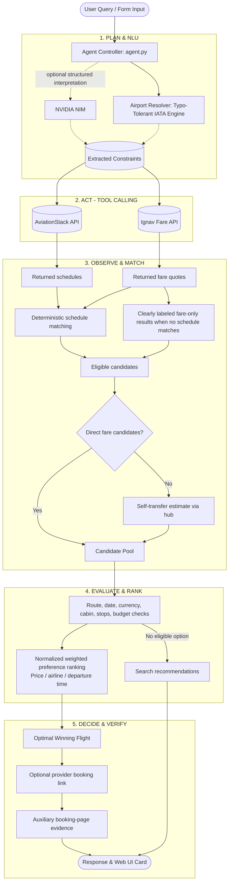

<div align="center">

# ✈️ AeroDecision AI — Flight Option Finder
### *Explainable flight decisions with independent fare/schedule/seat/booking verification*

[](https://python.org)
[](https://fastapi.tiangolo.com)
[](https://build.nvidia.com)

<br/>

[Explore Architecture](#-system-architecture) • [Getting Started](#-getting-started) • [Live Web App](#-web-dashboard) • [Test Suite](#-test-suite--verification)

</div>

---

## 📖 Executive Summary

**AeroDecision AI** (built on the T10 Flight Option Finder pipeline) is a Python flight-search application with a browser interface and FastAPI backend. It queries AviationStack for schedules and Ignav for fares when credentials and provider plans allow. NVIDIA NIM can optionally interpret an unresolved route in a natural-language request; deterministic validation, matching, filtering, and ranking remain in Python.

Unlike naive LLM wrappers that fabricate prices or guess flight numbers, this agent enforces a **strict boundary between intelligence and data validation**:
1. A deterministic parser handles supported natural-language fields first. When a route cannot be resolved and an NVIDIA key is configured, NIM may fill the missing route; output is validated as a `SearchRequest`, and service/output failures fall back to deterministic parsing.
2. Python enforces route, date, currency, cabin, stop, and budget constraints; schedule matching and preference ranking are deterministic.
3. AviationStack schedules, Ignav fare quotes, provider booking links, and auxiliary booking-page checks are distinct evidence sources. A fare quote, a schedule match, a booking-page check, and current seat availability are not interchangeable. The application does not guarantee bookability or live inventory.

---

## 🌟 Key Highlights & Innovations

### 1. 🛡️ Provider-sourced results
The application does not synthesize schedule or fare data. Results depend on configured providers, their response quality, account permissions, and freshness. A returned fare does not establish seat availability or final checkout price.

### 2. 🔄 Autonomous Multi-Hub Connecting Flight Synthesizer
For city pairs without direct nonstop flights (e.g. *Amritsar to Chennai*, *Vijayawada to Delhi*), point-to-point APIs often return zero domestic results or expensive international detours. Our agent dynamically:
- Queries primary domestic transit hubs: **Delhi (`DEL`)**, **Mumbai (`BOM`)**, **Bengaluru (`BLR`)**, and **Hyderabad (`HYD`)**.
- Validates layover windows (strictly between 1 hour and 12 hours).
- Enforces **Indian Cabotage Regulations** (filtering out foreign airlines like Malaysia Airlines or Gulf Air on domestic routes).
- Labels generated connections as separate-ticket self-transfer estimates. Combined totals are not confirmed as through-tickets, and each leg requires a separate booking.

### 3. 🌍 Comprehensive 140+ Indian Regional & Global Airport Resolver
- **India Domestic**: Complete coverage of all 140+ operational commercial airports, Tier-2/Tier-3 regional hubs, and UDAN stations (e.g., Amritsar `ATQ`, Ayodhya `AYJ`, Vijayawada `VGA`, Tirupati `TIR`, Dehradun `DED`, Leh `IXL`, Shirdi `SAG`, Darbhanga `DBR`).
- **Global Hubs**: Comprehensive mapping across Americas (JFK, LAX, SFO), Europe (LHR, CDG, FRA), Middle East (DXB, DOH, JED), Asia-Pacific (SIN, BKK, HND, SYD).
- **Typo-Tolerant Fuzzy Matching**: Integrated `difflib` with a `0.60` threshold that resolves colloquial spellings and typos (e.g., `"amrister"`, `"vijawada"`, `"mumbay"`, `"kolkatta"`).

### 4. 🧠 Multi-Turn Conversational Memory
The agent maintains context across conversation turns via `SessionMemory`. Following up with *"What about next week?"* or *"Change my budget to ₹8,000"* retains previous origin/destination context without re-prompting.

### 5. 💡 Smart Alternative Recommendations
When all flights exceed the requested budget, the agent does not produce a blank screen. It provides:
- Exact budget adjustment needed (*"Cheapest option is Air India AI599 at ₹6,388 (₹2,388 above budget)"*).
- Nearby departure/arrival airport alternatives.
- Date flexibility advice ($\pm 1$ to 3 days).

### 6. 🔗 Booking-link evidence
Provider booking links may be returned when available. The auxiliary booking-page verifier may report passed, partial, unavailable, or failed evidence; a search URL is not proof of a booking or of current fare/seat availability.

---

## 🏛️ System Architecture



---

## 🛠️ Provider helpers and tool schemas

`tools.py` defines schemas for two provider helpers. The current agent orchestrator calls schedule and fare providers directly; NVIDIA NIM request interpretation does not invoke tool calls.

```
+───────────────────+──────────────────────────────────────────+──────────────────────────────────────────────────────────+
| Tool Name         | Target Provider                          | Operational Purpose                                      |
+───────────────────+──────────────────────────────────────────+──────────────────────────────────────────────────────────+
| search_flights()  | AviationStack API (/v1/flights)          | Requests schedules when supported by the provider plan. |
| compare_price()   | Ignav API (/api/fares/one-way)           | Retrieves fare quotes and verification status. |
+───────────────────+──────────────────────────────────────────+──────────────────────────────────────────────────────────+
```

---

## 📂 Repository Structure

```
flights-agent/
|-- agent.py                 # Deterministic search orchestration
|-- airport_resolver.py      # Airport lookup and alias matching
|-- aviationstack_client.py  # Schedule provider client
|-- ignav_client.py          # Fare provider client
|-- llm_client.py            # Optional NVIDIA NIM route interpretation
|-- matching.py              # Schedule and fare matching
|-- ranking.py               # Candidate ranking
|-- models.py                # Pydantic domain models
|-- services/                # FX, trip, and decision service helpers
|-- engines/                 # Recommendation and decision engines
|-- scraping/                # Booking-page evidence helpers
|-- web_app.py               # FastAPI dashboard and API
|-- tests/                   # Unit and integration tests
|-- docs/                    # Regression and release validation notes
|-- notebook/                # Jupyter demonstration
|-- requirements.txt         # Python dependencies
|-- .env.example             # Environment configuration template
|-- README.md                # Project documentation
```

---

## 🚀 Getting Started

### 1. Prerequisites
- Python 3.11 or 3.12
- Git

### 2. Installation

```bash
# Clone the repository
git clone https://github.com/kollisathwikkumar/flights-agent.git
cd flights-agent

# Create and activate virtual environment
python3 -m venv .venv
source .venv/bin/activate  # On Windows: .venv\Scripts\activate

# Install dependencies
pip install -r requirements.txt
```

### 3. Environment Configuration

Copy the sample environment file and configure your API credentials:

```bash
cp .env.example .env
```

Edit `.env`:

```env
# AviationStack API
AVIATIONSTACK_API_KEY=your_aviationstack_key
AVIATIONSTACK_BASE_URL=https://api.aviationstack.com/v1

# Ignav Live Fares API
IGNAV_API_KEY=your_ignav_key
IGNAV_BASE_URL=https://ignav.com/api

# Optional NVIDIA NIM request interpretation
NVIDIA_API_KEY=your_nvidia_nim_key
NVIDIA_BASE_URL=https://integrate.api.nvidia.com/v1
NVIDIA_MODEL=nvidia/nemotron-3-nano-30b-a3b

# Normalized ranking weights (finite, non-negative values)
RANKING_PRICE_WEIGHT=0.3
RANKING_AIRLINE_WEIGHT=0.5
RANKING_DEPARTURE_WEIGHT=0.2
```

> [!IMPORTANT]
> Never commit `.env` to Git. It is automatically ignored by `.gitignore`.
> Values exported in the process environment take precedence over values in the local `.env` file. In deployment, provide credentials through the process environment or a managed secret store.

---

## 💻 Running the Application

### Option A: Launch Interactive Web Dashboard

```bash
python3 web_app.py
```

Visit **[http://127.0.0.1:8000](http://127.0.0.1:8000)** in your browser.

**Web Dashboard Features**:
- **Structured Flight Form**: Select origin, destination, date, budget/currency, passengers, cabin class, departure window, and maximum stops.
- **Natural Language Prompt Tab**: Type natural language queries.
- **Search Stepper**: Inspect the agent's recorded `PLAN` ➔ `ACT` ➔ `OBSERVE` ➔ `EVALUATE` ➔ `DECIDE` trace.
- **Recommendation Card**: Shows fare status, schedule-match status, availability caveat, freshness, booking-page evidence, and selection rationale separately.
- **Candidate Fares Table**: Inspect all candidate itineraries and exact match statuses.

### Power BI Analytics

Completed searches are stored locally in `flight_analytics.sqlite3` and exposed as a flat JSON array:

```text
GET http://127.0.0.1:8000/api/analytics/searches?limit=10000
```

In Power BI Desktop, choose **Get data → Web**, enter that URL, then expand the returned list into a table (name it `Searches`). Each row includes a unique `search_id`, request ID, search/record timestamps, route and request constraints, provider statuses and per-provider durations, schedule/fare/candidate counts, selected and lowest budget-currency fares, fare/schedule timestamps, fare verification, schedule matching, availability status, budget outcome/utilization, search outcome, and total duration. No raw query text, booking URL, or session cookie is stored in analytics. Set `ANALYTICS_DB_PATH` to choose another SQLite file. SQLite stores the records as flat JSON and the endpoint returns the JSON array for Power BI's Web connector.

Suggested report KPIs (create these as DAX measures after loading `Searches`):

```DAX
Total Searches = COUNTROWS(Searches)

Search Success Rate =
    DIVIDE(
        CALCULATE([Total Searches], Searches[flight_found] = TRUE()),
        [Total Searches]
    )

Verified Selection Rate =
    DIVIDE(
        CALCULATE([Total Searches], Searches[selected_fare_verified] = TRUE()),
        CALCULATE([Total Searches], Searches[flight_found] = TRUE())
    )

Average Search Duration (seconds) =
    DIVIDE(AVERAGE(Searches[search_duration_ms]), 1000)

Average Budget Utilization (%) =
    AVERAGE(Searches[budget_utilization_pct])

Provider Error Rate =
    DIVIDE(
        CALCULATE([Total Searches], Searches[search_outcome] = "provider_error"),
        [Total Searches]
    )

Average Ignav Duration (ms) =
    AVERAGE(Searches[ignav_duration_ms])
```

Useful visuals include searches over time, top origin/destination pairs, search success by route, verified vs. unverified selected fares, average latency, and budget utilization. Add a slicer for `budget_currency` or `fare_currency`: fare amounts in different currencies must not be summed or averaged together. `web_verification_status` is separate from `fare_status`; a verified API fare does not mean a booking page was independently verified. Refresh the endpoint periodically; its default response contains at most the most recent 10,000 searches.

The application exposes data suitable for a Power BI Web connector; it does not include or claim a deployed Power BI report. Suggested KPI calculations above are examples and should be filtered by currency wherever comparing monetary amounts.

The current `agent.py` search flow does not yet apply the ECB conversion helper in `services/fx_service.py`. Compare fares only when their currencies match; non-INR quote availability depends on the configured provider and market. The FX helper has unit coverage, but full cross-currency search integration is not passing the current suite.

The API binds to localhost by default and has no authentication. For Power BI Service refresh, host it behind an authenticated deployment and configure an on-premises data gateway or another supported network path; do not expose the local analytics endpoint publicly as-is.

### Current limitations

- Provider results are real only when valid keys, network access, and provider entitlements are available. Tests use mocked provider responses and do not certify live integrations.
- NVIDIA NIM request interpretation is optional and falls back to deterministic parsing; tests validate the client and fallback, not a live NIM deployment. NIM does not choose, match, or rank flights.
- NVIDIA model IDs and hosted endpoint availability can change independently of this application. The configured Nemotron 3 Nano model's free endpoint is marked deprecated by [NVIDIA](https://build.nvidia.com/nvidia/nemotron-3-nano-30b-a3b); confirm your account has an available endpoint or configure another supported `NVIDIA_MODEL`. NIM failures fall back to local parsing.
- Fare status, schedule matching, booking-page evidence, and seat availability are separate. The application does not complete bookings or confirm inventory.
- Connecting options are estimated separate-ticket self-transfers, not protected or confirmed through-tickets.
- This repository does not include a production deployment, authenticated public analytics endpoint, or a built Power BI report.

### Search Performance

Schedule and fare lookups run concurrently, and the agent reuses the first fare response for matching rather than querying the fare API a second time. Connecting-hub fare lookups are also issued concurrently. Booking-page verification is auxiliary and uses a five-second request timeout.

### Option B: Programmatic Python Agent CLI

```python
from agent import agent

# Run natural language flight search
result = agent.run("Find me a flight from Vijayawada to Mumbai on September 24 under ₹8,000")

# Print standardized response
print(result.formatted_response)

# Access structured candidate data & transparent trace
print(f"Candidates evaluated: {len(result.valid_candidates)}")
for step in result.trace:
    print(f"[{step.phase}] {step.content}")
```

### Option C: Jupyter Notebook Demo

Launch the notebook demo. The notebook was regenerated and all 15 code cells executed successfully in the latest local run:

```bash
jupyter notebook notebook/flight_agent_demo.ipynb
```

To execute every notebook cell from the command line and save the outputs back into the notebook, run `python execute_nb.py`. This performs provider requests where configured; use only when you intend to make those calls.

---

## 🧪 Test Suite & Verification

The automated unit and integration suite covers the following subsystems. Test counts are not hard-coded here; run the command below for the current results:

```bash
pytest -v tests/
```

### Latest local verification

Checked on 2026-11-20 after installing the refreshed dependencies:

- `pip check`: passed with no broken requirements.
- Dashboard smoke check using a temporary SQLite database: HTTP 200.
- Notebook pipeline: all 15 code cells executed, 16 outputs saved, and no cell errors. The runner now prints an ASCII success message so it works in the Windows console.
- `pytest -q`: **124 passed, 31 failed, 6 errors**. Failures cluster in agent/config FX integration, decision engines and service, Ignav parsing, ranking, and web-app trip endpoints. Examples include missing FX config/model fields and the missing `trip_store` web-app integration. These are implementation failures; the test suite did run to completion.

The existing tests are the coverage source; the list below does not imply that each module currently passes. Re-run the suite after fixing the failing integrations:

```bash
pytest -v tests/
```

### Test coverage

| Test Module | Coverage Area |
| :--- | :--- |
| `test_agent.py`, `test_config.py` | Request parsing, provider failures, configuration and budget handling |
| `test_airport_resolver.py`, `test_matching.py`, `test_connection_utils.py` | Airport resolution, flight matching, and connection validation |
| `test_ranking.py`, `test_decision_engines.py`, `test_decision_service.py`, `test_fx_service.py` | Ranking, recommendations, decision composition, and currency conversion |
| `test_ignav.py`, `test_aviationstack.py`, `test_scraping.py` | Provider response parsing and booking-page evidence |
| `test_analytics.py`, `test_trip_service.py` | Search analytics and saved trips |
| `test_llm_client.py`, `test_memory.py`, `test_models.py`, `test_tools.py` | NIM client, conversation memory, schemas, and tool helpers |
| `test_web_app.py`, `test_audits.py` | Dashboard/API routes and source audits |

---
## 📜 License

No `LICENSE` file is present in this repository, so this README does not declare a license. Add the project's chosen license file before distributing it under a specific license.
